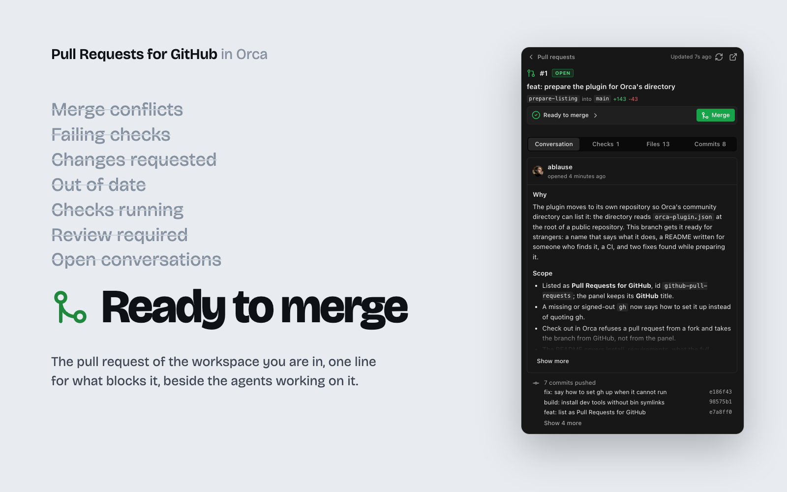

# Pull Requests for GitHub

The pull request of the workspace you are in, in a panel of [Orca](https://orca.dev)'s right sidebar: what stands between it and the merge, its conversation with the images at full size, its checks, files and commits. One step back, the repository's pull requests and issues, with the ones your agents and bots named or asked you about marked where they stand.



It follows the focused workspace, so switching worktrees switches the pull request. It reads GitHub through the GitHub CLI you already signed in to: there is no token to create.

## What you get

- **Status and merge.** One line says what blocks the merge, worst first: conflicts, failing checks, changes requested, out of date, checks running, review required, open conversations, or ready. The Merge button sits beside it, with the merge method, auto-merge, the admin bypass, draft and close one fold away.
- **The conversation, images first.** The pull request's images as thumbnails, each opening full size with zoom and pan. Then the description, reviews with their threads (Reply, Resolve, Open file), pushes and events, and a comment form.
- **Checks, files and commits.** Failing checks first, each opening its log. Changed files with their diffs, each opening in Orca's editor.
- **What your agents talk about.** A pull request or an issue an agent of the workspace named, in its terminal or in a bot's chat, carries a **Mentioned** tag in the list. One it asks you about (Claude Code's `AskUserQuestion`) carries a **Question** tag that quotes it, from the moment it asks until you answer.
- **Fix with agent.** For a failing check, a merge conflict or review comments, the panel drafts a message with the failing log lines or the comments, lets you edit it and pick an agent of the workspace, then pastes it into that agent's terminal.
- **Issues too.** An issue opens in the same panel with its labels, assignees, linked pull requests, images and conversation, and a form to comment, close or reopen it.
- **Anywhere in Orca.** Any pull request in the list opens in the panel, with **Check out in Orca** to start a worktree on its branch, or **Open agent** when an agent already works on it. With no repository focused, the panel lists your review requests, your pull requests and your issues.

## Install

Needs Orca 1.4.248 or newer and the [GitHub CLI](https://cli.github.com) signed in with `gh auth login` on the machine that runs Orca.

In Orca, open Settings, then Plugins, search for **Pull Requests for GitHub** and install it. Or from a terminal:

```sh
orca plugin install ablause/orca-github-pull-requests
```

Orca shows what the plugin may do and asks you to approve it. The panel appears as **GitHub** in the right sidebar.

## What it is allowed to do

The plugin runs its own code on your machine, as you, which Orca marks as **Full access**. Here is what that code does with it.

- **GitHub.** Every call goes through `gh` with your account, so the plugin sees what you can see on GitHub and acts with your permissions. It merges, comments, resolves threads or closes only when you press the button, and asks first for a merge.
- **Orca.** It reads your workspaces, their terminals and agents (`workspace:read`, `agent:read`) to follow the focused one. To find the pull requests your agents name, it reads what the focused workspace's terminals show when an agent ends a turn and what a bot's chat says, and sends GitHub only the `owner/repo#number` references it found. It hears Claude Code's `AskUserQuestion` calls through Orca's tool hooks, and never changes or blocks them.
- **Your terminals.** It types into a terminal (`terminal:send`) only when you press Send in Fix with agent, into the agent you picked. Check out in Orca runs `git fetch` and creates a worktree through Orca; Open agent switches to an agent's tab.
- **Storage.** It keeps the questions agents asked in its own storage (`storage:own`), so one asked while you were away is still marked when you come back.

It sends nothing anywhere but GitHub, through `gh`, and keeps no analytics.

## Limits

- Tested on macOS. The panel has no network of its own: the worker downloads each image and hands it over inline, shrinking those over 700 KB with `sips`, which only macOS has. Elsewhere a large image shows as a link to GitHub, and so do videos.
- Merging goes through `gh` against the repository and never touches your checkout. A merge is refused when commits landed after the panel last loaded.
- The panel asks GitHub for the pull request's state every 15 seconds while checks run and every 60 seconds otherwise, only while it is visible, and every 15 minutes once the pull request is merged or closed. The full page is fetched again only when that state changed. When GitHub's rate limit is reached, the plugin stops calling it until the limit resets.
- The timeline shows the last 150 events and the Files tab the first 300 files.
- Check out in Orca works for pull requests from branches of the same repository. A fork's pull request is refused, with the `gh pr checkout` command to use instead.
- A bare `#12` counts as a reference only inside a Git repository, and a one-digit `#7` only in a question, since "step #1" is prose more often than a reference.

## Develop

```sh
npm install
scripts/orca-types.sh .
npm run check
npm test
orca plugin dev watch .
```

`npm install` writes no symlinks (see `.npmrc`): Orca refuses a plugin folder that holds one, and `orca plugin dev watch .` loads this folder as it is.

## License

[MIT](LICENSE). The bundled Preact, htm and Lucide icons keep their own licenses, in `src/vendor`.
